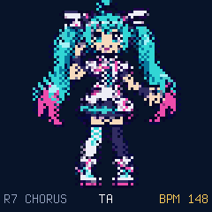
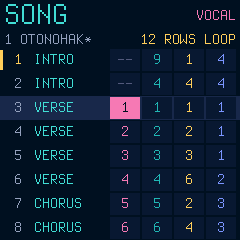
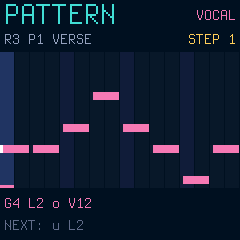
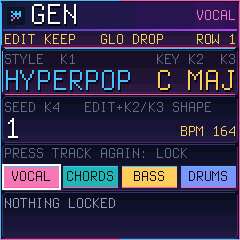

# Miku-FM

Feature-branch development now includes a ten-song library with four editable
factory songs, paired outfit animation, reusable stage effects and native
lyric/GEN controls. See [current handoff](CLAUDE_HANDOFF.md) and
[native integration notes](docs/NEXTGEN_NATIVE_INTEGRATION.md) for validation,
review images and remaining USB/hardware work. This is not a published release.

**A singing songwriter firmware for the M-VAVE FM-1.** A tiny pixel singer sings your songs in Japanese, consonants and
all, over FM chords, bass and drums. Shape her voice, write patterns or let her generate a whole song, and watch her dance.

<p>






</p>

**Try it in your browser, watch the trailer, install it:** https://michaelaperry.github.io/MIKU-FM1/ (the emulator runs the
real firmware package; the installer works in Chrome or Edge over USB).

- **Her voice:** a formant voice synthesised live (no samples): 73 Japanese mora selections with their consonants, five characters
  from DEEP to TINY, languages (Japanese, animal babble, scat, vowels), tension, fry, whisper, a harmony voice, vowels on
  the beat; chorus, delay, reverb, drive, tremolo. Every knob shows a picture of what it does.
- **The song:** four tracks (vocal, FM chords, bass, drums), 16 patterns per track, 64 rows with sections, mixer, swing,
  undo, 10 song slots. GEN adds five contemporary candidates alongside POP, BALLAD, DANCE and CHIP, with track locks and new phrases.
- **The singer:** her face mouths every vowel on STAGE; on DANCE she dances to the song.
- **Status:** development builds (0.x). Runs on a real FM-1 (installed with the browser installer; songs save and load).
  Controls: [docs/CONTROLS.md](docs/CONTROLS.md), manual: [docs/MANUAL.md](docs/MANUAL.md), what is measured:
  [docs/VALIDATION.md](docs/VALIDATION.md).
- **Other firmwares' data:** Miku-FM does not read other firmwares' projects or samples (see below). Back up first.
- **Licence:** code GPL-3.0-only; the singer is Hatsune Miku fan art under Crypton's Piapro Character License (free and
  non-commercial only): [LICENSING.md](LICENSING.md).

## The older host prototype

### Build and render an editable eight-bar song

Requires a C11 compiler and CMake 3.16+.

```sh
cmake -S . -B build
cmake --build build
ctest --test-dir build --output-on-failure
./build/miku_demo demo.wav demo.mik
```

The demo composes four patterns in C: vowel-melody, three-note FM-like chords, FM bass, and kick/snare/hat rhythm. It serializes the song to versioned CRC-checked `MIK1` bytes, decodes back to editable notes, and **renders from the decoded song** into 16-bit mono 22,050 Hz WAV.

`demo.mik` is a structured editable event file, **not** rendered audio. The demo is fixed eight bars (120 BPM); the UI, arrangement chaining, Japanese consonants, lyrics editing, and physical instrument support remain future work.

## Architecture

- `shared/song.h` — editable fixed-capacity 4-track event model
- `shared/song_io.c` — versioned little-endian binary codec and CRC32
- `firmware/sequencer/` — precomputed sorted sample-time event queues
- `firmware/audio/vocal/` — independently written five-vowel formant synthesizer
- `firmware/audio/band/` — original polyphonic chord FM, monophonic FM bass, electronic drums
- `tools/demo.c` — independent host harness rendering an eight-bar song

The 0.5 firmware (`native/dinghy.c`) is built from newer modules: `firmware/song/` (song model, MKS2 file format, sequencer, mora table, demo song), `firmware/audio/fmband/` (FM chords, bass, drums, mixer), `firmware/audio/fvoice/` (the voice) and `firmware/app/engine.c` (the dispatch that runs in the audio interrupt). `tools/song_render.c` renders the demo through the same engine on the host: `./build/firmware/app/song_render otonohako.wav`.
- `tests/` — unit, serialization, and host-demo smoke tests

The current instruments use simplified synthesis and no effects, and there is no claim of measured audio or CPU quality on FM-1 hardware. See `docs/RESEARCH.md`, `docs/SONG_FORMAT.md`.

Host-engine code is MIT licensed; the firmware package is GPL-3.0-only (see Licence). Miku-FM is an unofficial fan project and has no relationship to Crypton, Yamaha or VOCALOID (see LICENSING.md). No voicebanks or proprietary assets are included.

## Other firmwares' data

Miku-FM does not read other firmwares' projects or samples. It stores its songs in Dinghy's 10 slots (FM-1 flash 0x97000...) and a small settings struct in the settings sector (0xFC000), which other Felucca-family firmwares also use, so saving there replaces their data. Back up first.

## Licence

The code is GPL-3.0-only (`LICENSE`; the firmware is built on [Dinghy](https://github.com/zvenson/dinghy)); files marked
`SPDX-License-Identifier: MIT` are MIT (`LICENSES/MIT.txt`). The singer's art is **fan art of Hatsune Miku under Crypton's
Piapro Character License**: free and non-commercial only, not under the GPL. Details, the credit and the list of art
files: [LICENSING.md](LICENSING.md).

この作品はピアプロ・キャラクター・ライセンスに基づいてクリプトン・フューチャー・メディア株式会社のキャラクター「初音ミク」を描いたものです。
© Crypton Future Media, INC. www.piapro.net — Miku-FM is an unofficial fan project, not associated with Crypton Future
Media, Yamaha or M-VAVE. 「初音ミク」 is a registered trademark of Crypton Future Media, INC.; VOCALOID of Yamaha Corporation.
