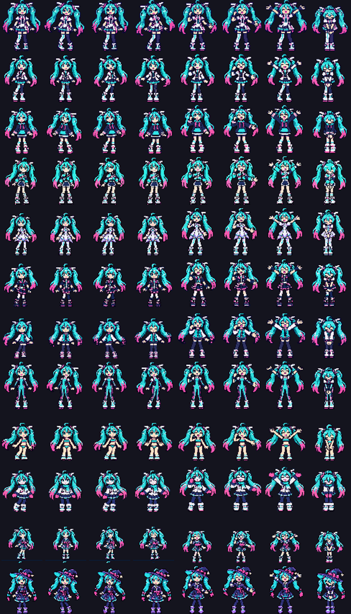
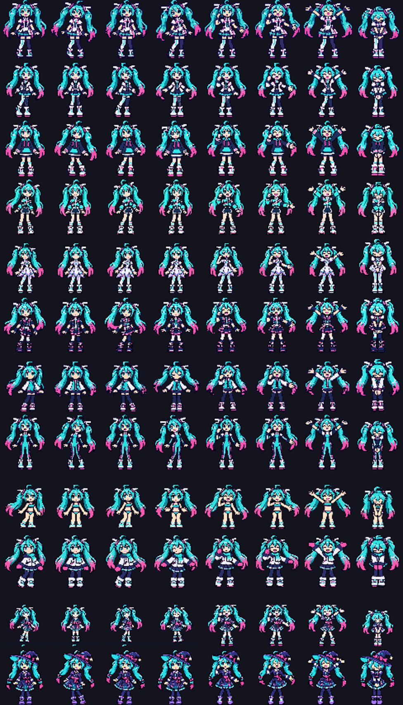
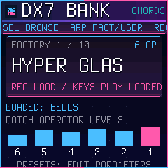
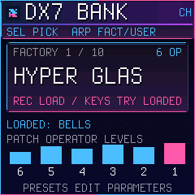
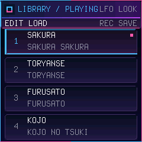
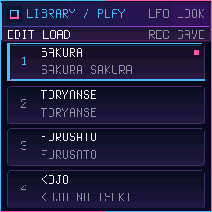

# 0.8 review evidence

These images are **host evidence**, not CPU emulator or device screenshots.
The sprite contact sheets decode the actual firmware atlases, in outfit order,
with the eight DANCE frames left to right:

| Before | After |
| --- | --- |
|  |  |

The added wardrobe upright frames now share a silhouette height before atlas
packing; frame 7 remains a bow. Original art remains pixel-exact. Pose-dependent
widths and head angles are intentional, not dynamic renderer scaling.

The BANK/LIBRARY host screenshots execute the actual native UI with pinned
Dinghy's fake host backend. A validation-only shim supplies absent timer, random
and USB-send APIs; these images establish text layout only, not timings or USB.

| Page | Before | After |
| --- | --- | --- |
| BANK browse |  |  |
| LIBRARY playing |  |  |

The [native CI gallery](native-ci/README.md), once generated, contains actual
emulator images for all edit pages and both tracks, with a manifest identifying
the exact tested source and package hashes. Failed runs are labeled separately.
`tests/test_page_text.py` executes real `pg_bank`/`pg_library`, applies pinned
FONT_S 8x16 and FONT_L 16x32 advances, and rejects text bounds or intersections.
It covers both tracks, all 11 bank pages, all operators, factory/user sources,
pending-store hints, every library cursor/current slot and playback state,
modified long names, and name-entry layout/save-failure handling. Non-text
panel/rim graphics are intentionally excluded from text intersection checks.

Reproduce host validation from the repository root after activating the setup
venv:

```sh
cmake -S . -B build/host -DCMAKE_BUILD_TYPE=Release
cmake --build build/host --parallel 5
ctest --test-dir build/host --output-on-failure -j 5
build/host/playback_bench
python3 tools/wardrobe_pack.py --check
python3 tests/test_native_video.py build/dinghy
```

For native acceptance, install the authentic pinned JieLi toolchain and AC79 SDK
as documented by Dinghy, then run default and `--video` builds sequentially and
`tools/emu_smoke.sh` against each resulting package. Retain the existing image
ceiling 581564 and static/pool reserves 16384/32768. Both flash variants and MKS2
v4/v5 remain required. Do not install experimental firmware on the owner's unit:
Claude review and main integration precede any owner hardware testing.

Native telemetry exposes `stage_profile` and `dance_profile` frame counts,
last timestamp, minimum/maximum changed-frame intervals, total draw ticks and
maximum draw ticks. These measure changed-frame update draws (not initial full
redraws); STAGE mouth updates are event driven, so their interval includes gaps
without mouth changes. `audio_calls`, `audio_ticks`, `audio_frames`,
`audio_hard_peak`, `audio_overruns` expose steady callback totals/worst/overruns.
At 24 ticks/us, sample deltas frequently (32-bit wrap) to calculate mean draw,
audio share of elapsed time, and interval spread. Record full-song min/max and
audio overrun deltas on emulator, then through the owner's approved hardware
process. Compare identical song, outfit/effects and duration; never equate host
clock measurements with CPU emulator or physical callback deadlines.

USER BANK naming: stop playback, browse USER with ARP, select the slot, press
EDIT; SELECT chooses a letter, K1 changes its printable character, REC saves and
GLO cancels. Persistence uses the existing checked blob storage and does not
change MKS2. A loaded song's embedded copy remains independent of its bank slot.


USB-video follow-up: the camera terminal now declares its three-byte control
bitmap consistently with its 18-byte descriptor; suspend and endpoint timeout
no longer permanently stop the selected stream. A generation attached to every
immutable JPEG rejects stale publications across alt changes, reset and resume.
The JPEG sampler uses twelve cached 61-pixel index rows (732 index bytes), with
no framebuffer or heap. All wardrobe encoder fixtures compare the cached JPEG
byte-for-byte to the reference. The adapter test sends 150 consecutive frames
through the real patched driver and reconstructs each frame exactly.

`video_usb.session_frames/session_bytes`, `first_frame_ms/last_frame_ms`, and
`interval_min_ms/interval_max_ms` measure completed transfers for the current
stream. Average delivered FPS is `(session_frames-1)*1000/(last_frame_ms-first_frame_ms)`
when at least two frames complete; encoding counters alone do not establish
transmission. `video_min_bytes/video_max_bytes/video_total_bytes` describe
encoder output, and `video_step_ticks/video_frame_ticks/video_total_ticks`
describe encoding cost. Counters remain diagnostic until measured on an actual
host after the owner's review/main-integration process.
