# Native 0.8 review evidence

Generated from verified code `a6ad1ec278cc1c859d442052ea6a4a1f042266f0`. CPU emulator only; no physical USB or device qualification.

| Track / page | v0.7 baseline | 0.8 candidate |
| --- | --- | --- |
| chords / library-stopped |  | 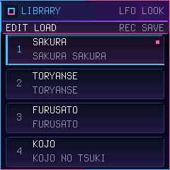 |
| chords / library-playing | 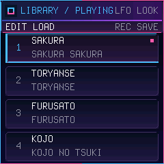 |  |
| chords / bank-00-browse | 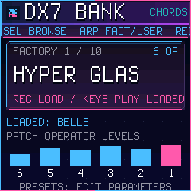 | 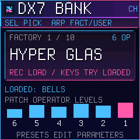 |
| chords / bank-01-global | 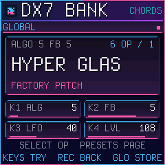 | 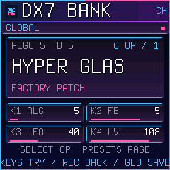 |
| chords / bank-02 | 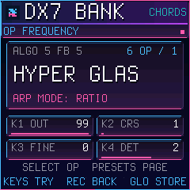 | 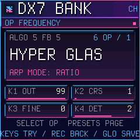 |
| chords / bank-03 | 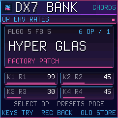 |  |
| chords / bank-04 | 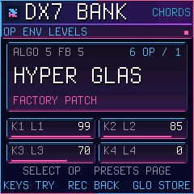 | 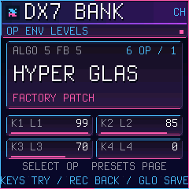 |
| chords / bank-05 | 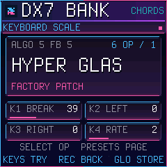 |  |
| chords / bank-06 | 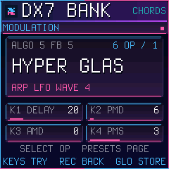 | 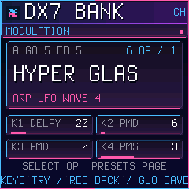 |
| chords / bank-07 | 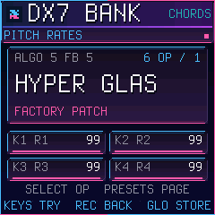 | 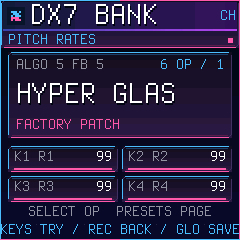 |
| chords / bank-08 | 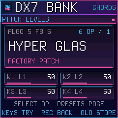 | 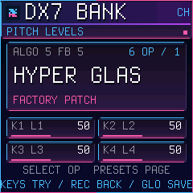 |
| chords / bank-09 | 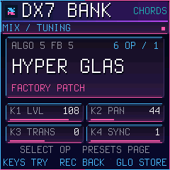 | 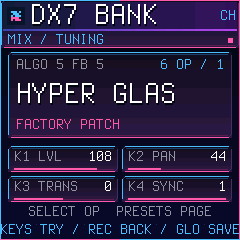 |
| chords / bank-10 | 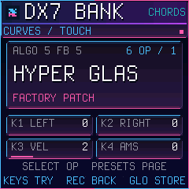 | 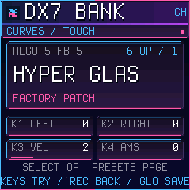 |
| bass / library-stopped | 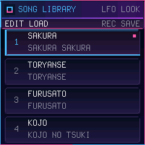 |  |
| bass / library-playing |  |  |
| bass / bank-00-browse | 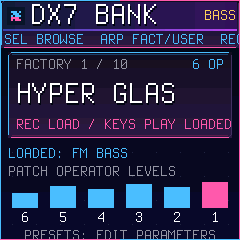 | 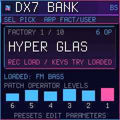 |
| bass / bank-01-global | 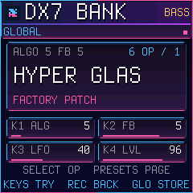 | 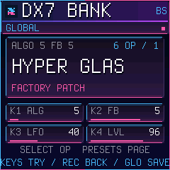 |
| bass / bank-02 | 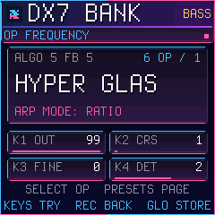 |  |
| bass / bank-03 | 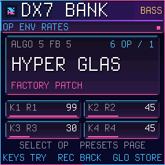 | 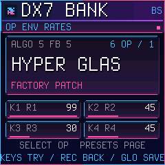 |
| bass / bank-04 | 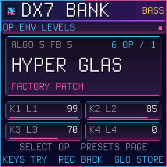 | 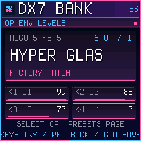 |
| bass / bank-05 | 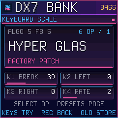 | 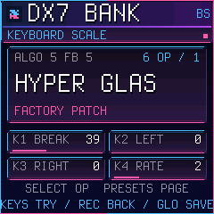 |
| bass / bank-06 | 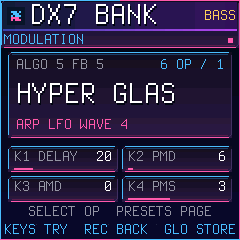 |  |
| bass / bank-07 | 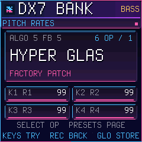 |  |
| bass / bank-08 | 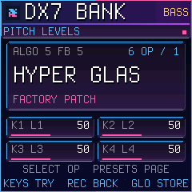 |  |
| bass / bank-09 | 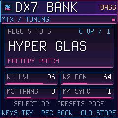 | 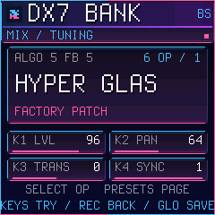 |
| bass / bank-10 | 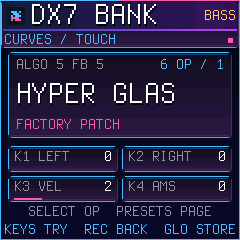 |  |

Measurements: [STAGE baseline](stage-baseline/measurements.json), [STAGE candidate](stage-default/measurements.json), [DANCE baseline](dance-baseline/measurements.json), [DANCE candidate](dance-default/measurements.json), [JPEG benchmark](jpeg-bench/measurements.json).
